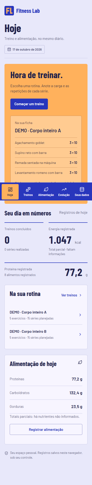

# Fitness Lab

Aplicativo pessoal de treinos e alimentação, em português do Brasil. React + TypeScript + Vite, com persistência IndexedDB no navegador. **Versão 0.2.0.**

Experimento de desenvolvimento majoritariamente por IA, com especificação, delegação, implementação e revisão independente. O código está em [cristianworth/fitness-lab](https://github.com/cristianworth/fitness-lab).

## Por que este projeto existe

O Fitness Lab nasceu como um projeto pessoal de estudo e possível portfólio: construir um diário de academia utilizável e observar como agentes de IA conduzem um projeto completo, do alinhamento de produto à validação. O foco é registrar o que aconteceu no treino e na alimentação, preservando o significado do histórico.

O público inicial é uma pessoa usando um dispositivo. Isso orientou uma aplicação sem conta, servidor de dados ou serviços pagos, com controle local dos registros e backup exportável. O projeto também serve como exemplo de React e TypeScript para quem quer estudar formulários, regras de domínio, persistência no navegador e testes.

É um experimento em evolução, sem garantia de adequação clínica. Não prescreve treinos ou dietas e não estima gordura corporal. A versão publicada contém os fluxos descritos abaixo; propostas futuras estão separadas do que já funciona.

## Como foi construído

Cristian definiu o objetivo, escolheu as prioridades de produto e autorizou as entregas. Agentes de IA fizeram pesquisa, especificação, implementação, testes e revisão do código. O agente principal coordenou contratos e integração; subagentes trabalharam em dados, interface e pesquisa/revisão. O desenvolvimento inicial foi realizado com Codex; os subagentes usaram GPT-6.1 Sol com raciocínio alto, conforme registrado na validação.

O processo usou desenvolvimento orientado por especificação (SDD) em documentos Markdown: requisitos e critérios de aceitação antes da implementação, entregas coesas no Git, revisão independente por outro agente e verificação pela interface. O uso de IA não substitui a responsabilidade de revisar alterações: os testes verificam comportamentos específicos e têm limites documentados.

Leia o [relato de desenvolvimento](docs/development.md), a [arquitetura](docs/architecture.md) e as [evidências de validação](docs/validation.md). Esses documentos explicam decisões e resultados observados, sem pressupor que outro agente ou execução produza o mesmo código.

## Identidade visual e portfólio


O redesign de outubro de 2026 partiu de uma crítica de Cristian: a interface cinza e branca e o ícone genérico não davam personalidade ao projeto. A direção escolhida foi um **caderno de treino com identidade esportiva**: títulos compactos, cores fortes e uma ficha com os exercícios e séries da própria rotina no painel inicial.

O símbolo **FL** foi desenhado em SVG com traços modulares, sem depender de uma fonte ou de um ícone de academia pronto. O mesmo arquivo aparece na aba do navegador, na barra lateral e no cabeçalho móvel. Os ícones Lucide continuam indicando ações e navegação; não representam a marca.


<details>
<summary>Ver a interface no celular</summary>



</details>

Capturas da aplicação em navegador, com dados sintéticos da demo e relógio fixado em 17/10/2026. A imagem móvel inclui a página completa; a navegação permanece fixa na base da janela durante a rolagem. Não são mockups nem registros pessoais.

| Decisão                                      | Aplicação no projeto                                                                        |
| -------------------------------------------- | ------------------------------------------------------------------------------------------- |
| Cobalto `#2836BC` e laranja `#FFB15C`        | Navegação e destaque para começar/retomar o treino.                                         |
| Lavanda `#E8E8FA` e painel `#F7F5FF`         | Fundo e superfícies de leitura, sem a antiga predominância de cinza/branco.                 |
| Tinta `#22234B` e texto secundário `#5D5D7C` | Hierarquia entre conteúdo principal, unidades e orientações.                                |
| Barlow Condensed 700                         | Títulos e números, com proporção compacta que remete às fichas e à sinalização esportiva.   |
| Barlow 400/600                               | Formulários, listas e leitura cotidiana. Arquivos servidos localmente.                      |
| Conteúdo do próprio usuário                  | Prévia da rotina substitui a ilustração decorativa; estados vazios explicam a próxima ação. |

**Fontes e referências:** [Barlow, de Jeremy Tribby](https://tribby.com/fonts/barlow/), distribuída pelo [Google Fonts](https://github.com/google/fonts/tree/main/ofl/barlow), e [Barlow Condensed](https://github.com/google/fonts/tree/main/ofl/barlowcondensed). As fontes usam SIL Open Font License 1.1; [origem, licenças e hashes dos arquivos](public/fonts/FONT-SOURCES.md) acompanham o repositório. Contraste e dimensões dos controles foram orientados pelas referências [W3C: contraste mínimo](https://www.w3.org/WAI/WCAG22/Understanding/contrast-minimum.html) e [W3C: tamanho mínimo dos alvos](https://www.w3.org/WAI/WCAG22/Understanding/target-size-minimum.html). A paleta, a composição e o monograma são decisões deste projeto, não um template dessas fontes.

O [estudo visual](docs/visual-design.md) detalha o problema, as escolhas, a implementação e os limites da validação. O redesign preserva o esquema de backup, o banco local e as regras de treino e alimentação.

## Executar localmente

Requisitos: Node.js **24 LTS recomendado** (mínimo 22.12), npm e navegador moderno. O projeto não exige banco externo, login, chave de API ou arquivo `.env`.

```sh
git clone https://github.com/cristianworth/fitness-lab.git
cd fitness-lab
npm ci
npm run dev
```

Abra **http://127.0.0.1:5173**. Mantenha o terminal aberto; `Ctrl+C` encerra o servidor. Para iniciar novamente, use `npm run dev` no mesmo diretório.

Para conferir a versão de produção:

```powershell
npm run build
npm run preview
```

Encerre o servidor de desenvolvimento antes de abrir o preview, que usa o mesmo endereço e porta para preservar a origem dos dados. A porta é fixa: se estiver ocupada, encerre o outro servidor, em vez de trocar o endereço sem exportar um backup.

## O que está incluído

- Painel de hoje, treinos concluídos, energia e proteína registradas.
- Cadastro/edição de exercícios e rotinas com séries e repetições planejadas.
- Uma sessão ativa por vez, rascunhos por série, conclusão e retomada após recarga.
- Histórico com nomes, planejamento e execução preservados. Evolução por maior carga e volume de carga externa.
- Cadastro de alimentos por 100 g ou 100 ml; diário com quantidade, refeição e data; correção e remoção de consumo.
- Backup JSON validado, exportação, restauração atômica e recuperação mesmo após falha de leitura do banco.
- Layout responsivo, navegação por teclado, estados vazios e feedback de gravação.

## Experimentar os fluxos

1. **Treinos → Exercícios → Novo exercício:** crie “Agachamento de exemplo”, grupo “Pernas”. São dados fictícios para experimentar, não uma prescrição.
2. **Rotinas → Nova rotina:** crie “Rotina de exemplo”, adicione o exercício e defina duas séries de dez repetições.
3. **Iniciar treino:** informe repetições e carga em kg. **Concluir** salva e marca a série como feita; o botão com ícone de disquete salva somente o rascunho. Alterações ainda não salvas bloqueiam a saída e a finalização até você salvar.
4. Recarregue depois de salvar: a sessão deve continuar disponível. Conclua uma série e **Finalize o treino**. Em **Evolução**, abra os detalhes e alterne entre maior carga e volume.
5. **Alimentação → Meus alimentos:** cadastre um alimento fictício com 120 kcal e 10 g de proteína por 100 g. Deixe um nutriente em branco para observar a indicação de total parcial.
6. **Diário alimentar:** registre 150 g; o resultado esperado é 180 kcal e 15 g de proteína. Edite a quantidade para 200 g: 240 kcal e 20 g de proteína. Troque a data para consultar outro dia.
7. Edite os nutrientes do alimento no cadastro. O consumo anterior mantém os valores originais; novos consumos usam o cadastro atualizado.
8. **Seus dados → Exportar backup:** guarde o JSON. Importe-o, confira o resumo e confirme a substituição somente se quiser restaurar esse arquivo. Arquivos inválidos não alteram os registros.

O app começa vazio. Os exemplos acima e os dados dos testes são fictícios. Testes automatizados usam perfis isolados e não alteram seus registros pessoais.

### Demonstração com histórico

Está disponível um [arquivo JSON demonstrativo](public/demo/fitness-lab-demo.json) com 24 treinos, 2 rotinas, 10 exercícios, 12 alimentos da TACO e 55 dias de alimentação fictícia. Com o app rodando, [baixe o arquivo local](http://127.0.0.1:5173/demo/fitness-lab-demo.json) e importe em **Seus dados**. A importação substitui os registros: exporte seu backup antes. A demo não é carregada automaticamente.

Veja [fontes, unidades, datas e limites da simulação](docs/demo-data.md). `npm run demo:generate` reproduz o arquivo. Em Evolução, o supino passa de 30 a 35 kg com platôs e uma semana mais leve. O app não mede composição ou definição corporal.

## Dados, unidades e limites

- Dados pertencem à **origem + perfil do navegador**. `localhost` e `127.0.0.1`, portas diferentes e outros navegadores possuem bancos distintos. A aplicação não sincroniza dispositivos.
- Limpar dados do site, encerrar navegação privada ou a política de armazenamento do navegador pode remover registros. **Exporte backups regularmente.** “Solicitar proteção dos dados” é uma tentativa sujeita à decisão do navegador, não uma garantia.
- Backup contém todos os registros em JSON, esquema `1`, máximo **20 MiB em UTF-8**. Importação valida estrutura, limites, datas, IDs e referências antes de substituir os dados. Mantenha esses arquivos privados e fora do repositório.
- Gravação é transacional. Alterações excedendo os limites ou falhando por falta de espaço não substituem o estado anterior. Há um limite conservador para manter o estado sempre exportável.
- Quilogramas representam **carga externa**. Exercício com peso corporal pode usar 0 kg; o peso corporal não é estimado. Volume = repetições × carga externa de séries feitas em sessões concluídas.
- Nutrientes: energia em kcal; proteína, carboidrato e gordura em g por 100 g/ml. Não existe conversão automática de g para ml. Zero é conhecido; campo vazio é desconhecido. Totais parciais são identificados.
- Fuso inicial: `America/Sao_Paulo`. Sessão pertence ao dia do início nesse fuso; datas do diário são datas civis, sem conversão acidental para UTC.
- Limites de entrada: 30 séries planejadas por exercício, 100 séries registradas por exercício/sessão, 1.000 repetições, 2.000 kg externos, 100.000 g/ml por consumo e 10.000 por valor nutricional. São limites técnicos, não recomendações de saúde.

## Verificar o projeto

```powershell
npm run check
npm run test:e2e
npm run format:check
```

`check` executa Vitest, TypeScript e build Vite. `format:check` confere o padrão Prettier; `npm run format` aplica a formatação. Testes de navegador usam Microsoft Edge instalado no Windows e Chromium no Linux. Para instalar o navegador no Linux/macOS: `npx playwright install chromium` (em Linux CI: `npx playwright install --with-deps chromium`).

O ambiente inicial usa Windows 10 e Node 24.20.0. Playwright atual documenta suporte a Windows 11+; a execução local com Edge é evidência observada, não garantia de suporte oficial ao Windows 10. O workflow GitHub Actions executa os mesmos checks em Ubuntu.

Testes cobrem snapshots, cálculos, datas, reenvios, concorrência, limites/rollback e os fluxos pelo navegador em desktop e viewport móvel. Axe verifica problemas de acessibilidade detectáveis automaticamente; isso não substitui avaliação humana com tecnologias assistivas. Relatórios e capturas ficam ignorados em `test-results/` e `playwright-report/`.

## Organização e decisões

`src/domain.ts` contém regras puras e validações. `src/repository.ts` implementa IndexedDB. `src/App.tsx` integra navegação, visão do dia e backups. `src/pages/` contém treinos, alimentação e evolução. Contratos estão em `src/types.ts`.

SDD proporcional em Markdown: [requisitos](docs/spec.md), [plano](docs/plan.md), [decisões e fontes](docs/decisions.md), [validação](docs/validation.md), [retomada](docs/handoff.md) e [changelog](CHANGELOG.md).

## Contribuir e acompanhar

Contribuições podem melhorar documentação, acessibilidade, testes e fluxos existentes. Comece pelo [guia de contribuição](CONTRIBUTING.md). Para defeitos e propostas, use as [issues](https://github.com/cristianworth/fitness-lab/issues), com exemplos fictícios e passos reproduzíveis. Problemas que possam expor registros devem seguir a [orientação de segurança](SECURITY.md).

Possíveis próximos passos são PWA/offline, edição de treinos finalizados, cancelamento de sessão e medidas corporais. São ideias para discussão, sem prazo ou compromisso de implementação. Contas, sincronização, integrações nutricionais e hospedagem pública exigem revisar o escopo e a privacidade. O responsável pelas decisões e releases é [cristianworth](https://github.com/cristianworth).

## Licença e créditos

O código e a documentação originais são disponibilizados sob a [licença MIT](LICENSE). Consulte os [créditos e materiais de terceiros](NOTICE.md): dependências mantêm suas próprias licenças, e as referências nutricionais e de treinamento não são de autoria do projeto. O campo `private` do package.json impede publicação acidental no npm; o repositório continua público.

## Limitações desta versão

Sem contas, sincronização, catálogo nutricional externo, prescrição de dieta/treino, exclusão de cadastros ou edição de treinos finalizados. Correções de alimentação estão disponíveis. Rascunhos de séries usam gravação explícita; não feche o navegador antes de salvar.

Não há service worker ou instalação PWA: o servidor precisa estar disponível para abrir o app. A interface foi projetada para celular e testada com viewport móvel; uso em celular físico exige servir a aplicação em contexto seguro (HTTPS). Hospedagem pública da aplicação não foi realizada. O repositório GitHub público contém código, documentação e dados sintéticos de demonstração, sem registros pessoais reais.
