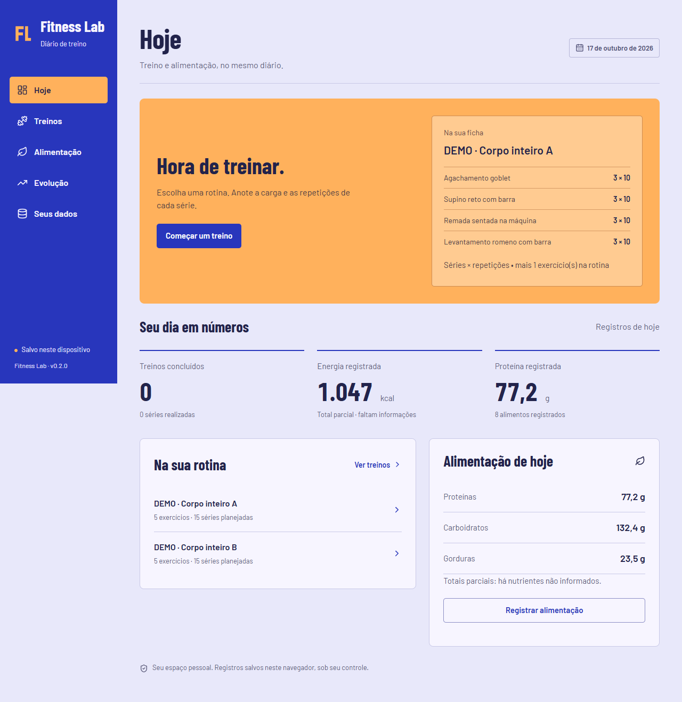

# Fitness Lab

Diário pessoal de treinos e alimentação para registrar o que você fez e acompanhar o histórico. Organize rotinas, retome uma sessão e consulte cargas, volume, energia e proteína sem criar conta ou configurar um servidor de dados.

## Experimente localmente

**A versão online ainda não foi publicada.** [Execute o aplicativo](#executar-localmente) e use o [arquivo de demonstração](public/demo/fitness-lab-demo.json) com treinos e alimentação fictícios. A importação substitui os dados existentes: exporte um backup antes de testar os exemplos.



Captura da aplicação com dados sintéticos e relógio fixado em 17/10/2026. [Interface móvel e decisões visuais](docs/visual-design.md).

## O que você pode fazer

- Cadastrar exercícios e rotinas com séries e repetições planejadas.
- Iniciar, salvar e retomar uma sessão, mantendo planejamento e execução distintos.
- Consultar treinos concluídos e evolução por maior carga ou volume de carga externa.
- Cadastrar alimentos e registrar consumo por quantidade, refeição e data, com correção e remoção.
- Exportar e restaurar backups JSON validados antes da substituição dos registros.
- Usar a interface em computador ou celular, com feedback de gravação e navegação por teclado.

O app não prescreve treinos ou dietas, não estima composição corporal e não sincroniza dispositivos. [Uso, unidades e limites](docs/usage.md).

## Stack e decisões

| Parte                | Escolha e motivo                                                                                              |
| -------------------- | ------------------------------------------------------------------------------------------------------------- |
| Interface            | React, TypeScript e Vite para formulários e navegação.                                                        |
| Dados                | IndexedDB com idb, transações e backup exportável; sem backend ou conta para o uso inicial em um dispositivo. |
| Regras e verificação | Regras puras de domínio, validação de backup e testes Vitest/Playwright dos comportamentos relevantes.        |

O histórico mantém os valores usados no momento do treino ou consumo, mesmo após alterar um cadastro. Importações inválidas e gravações que falham não devem substituir o estado anterior. [Arquitetura](docs/architecture.md) e [evidências e limites da validação](docs/validation.md).

## Executar localmente

Requer Git, Node.js 22.12+ (24 recomendado), npm e navegador moderno. Sem chave de API ou arquivo de configuração privado.

```sh
git clone https://github.com/cristianworth/fitness-lab.git
cd fitness-lab
npm ci
npm run dev
```

Abra **http://127.0.0.1:5173**. Os dados pertencem à origem e ao perfil do navegador. Trocar host/porta não transporta registros; limpar os dados do site pode apagá-los. [Guia de uso e backup](docs/usage.md).

## Estado e desenvolvimento

Versão **0.2.0**, com identidade visual esportiva, persistência local e dados demonstrativos. Não há instalação PWA, edição de treinos finalizados ou hospedagem pública nesta versão.

Cristian definiu o objetivo e as prioridades e avaliou o produto. Agentes de IA conduziram pesquisa, especificação, implementação, testes e revisão. O repositório registra esse processo e seus limites, sem apresentar geração de código como domínio manual da stack. [Relato de desenvolvimento](docs/development.md).

## Verificar e contribuir

```sh
npm run check
npm run test:e2e
npm run format:check
```

- [Contribuição](CONTRIBUTING.md) e [issues](https://github.com/cristianworth/fitness-lab/issues).
- [Segurança e privacidade](SECURITY.md).
- [Dados demonstrativos](docs/demo-data.md), [decisões](docs/decisions.md) e [identidade visual](docs/visual-design.md).
- [Changelog](CHANGELOG.md): entregas publicadas; ideias futuras não são funcionalidades disponíveis.

Código e documentação originais sob [MIT](LICENSE). [Créditos e materiais de terceiros](NOTICE.md) preservam as licenças e atribuições de fontes, dependências e referências nutricionais.
