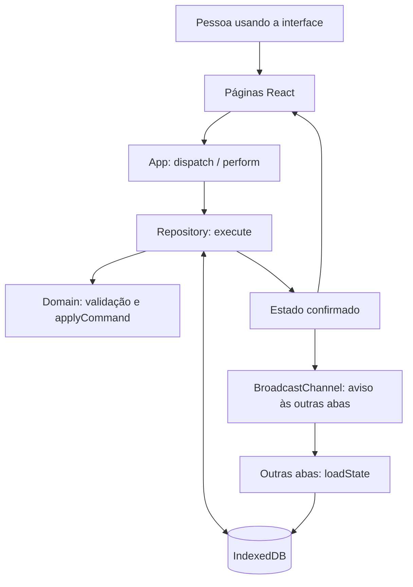

# Arquitetura e fluxo dos dados

Este documento descreve a implementação da versão 0.1.2. Para motivação das escolhas, consulte [decisões técnicas](decisions.md); para regras de produto, consulte a [especificação inicial](spec.md).

## Visão geral

O Fitness Lab é uma SPA em React/TypeScript servida pelo Vite em desenvolvimento e compilada para arquivos estáticos em `dist/`. Não existe API própria, autenticação ou banco remoto. A biblioteca `idb` fornece uma interface de promises para o IndexedDB do navegador; Zod valida comandos e backups em execução.

## Responsabilidades

| Caminho                                          | Responsabilidade                                                                                         |
| ------------------------------------------------ | -------------------------------------------------------------------------------------------------------- |
| `src/types.ts`                                   | Contratos `AppState`, `Command`, sessões, séries, alimentos e consumos.                                  |
| `src/domain.ts`                                  | Validação, cálculo de nutrientes, datas, aplicação pura dos comandos e serialização de backup.           |
| `src/repository.ts`                              | Leitura, transações de escrita e restauração no IndexedDB.                                               |
| `src/App.tsx`                                    | Carregamento, navegação, painel do dia, despacho de comandos, feedback, backup e comunicação entre abas. |
| `src/pages/Workouts.tsx`                         | Cadastros, rotinas, sessão ativa e rascunhos das séries.                                                 |
| `src/pages/Nutrition.tsx`                        | Catálogo manual, diário alimentar e correção de consumos.                                                |
| `src/pages/History.tsx`                          | Sessões concluídas e evolução de carga/volume por exercício.                                             |
| `src/styles.css`                                 | Estilos compartilhados e adaptação a telas menores.                                                      |
| `scripts/generate-demo.mjs`                      | Geração determinística de dados fictícios, sem acesso ao banco do usuário.                               |
| `src/*.test.ts`, `scripts/demo.test.mjs`, `e2e/` | Testes de domínio, persistência, dataset e fluxos reais no navegador.                                    |

## Uma escrita, do formulário ao histórico

Ao concluir uma série, a página envia um `Command` com os identificadores, repetições e carga. O App coordena o estado de operação e chama `execute`. O repositório abre uma transação `readwrite`, lê o estado persistido mais recente e chama `applyCommand`. Antes de salvar, valida se o novo estado continua exportável. Só retorna sucesso depois de confirmar a transação.

O App atualiza a interface com o estado confirmado e avisa outras abas. O BroadcastChannel é uma notificação local; não sincroniza dispositivos. No editor de séries, rascunhos conflitantes são tratados explicitamente. Os IDs estáveis para reenvio e as transações ajudam a evitar duplicação e perda de escritas concorrentes; não há mecanismo distribuído de sincronização.

## Modelo e significado histórico

- `Exercise` é um cadastro; `Routine` organiza referências a exercícios e metas de séries/repetições.
- `Session` copia nomes e planejamento quando começa. `SessionExercise` mantém `plannedSets`/`plannedReps`, enquanto `WorkoutSet` registra o realizado e se a série foi concluída. Há no máximo uma sessão ativa.
- `Food` informa nutrientes por 100 g ou 100 ml. `Meal` representa um **item consumido**, não uma refeição inteira: guarda quantidade, data, tipo de refeição e uma cópia do nome/unidade/nutrientes do alimento.
- Editar uma rotina ou alimento não recalcula registros antigos. Esse snapshot preserva o contexto no qual o dado foi registrado.
- `null` significa desconhecido; zero é conhecido. Carga é sempre externa, em kg. O peso corporal não é estimado. Gramas e mililitros não são convertidos.

Consumo nutricional = valor por 100 unidades × quantidade / 100. Totais usam os valores conhecidos e sinalizam informação incompleta. Evolução usa séries concluídas de sessões finalizadas; volume = soma de carga externa × repetições.

## Persistência, datas e backup

O banco `fitness-lab`, versão IndexedDB 1, contém o object store `state`; o estado completo fica na chave `current`. Um único documento simplifica restauração atômica e validação global, ao custo de ler/validar/gravar o conjunto em cada alteração. É uma escolha para uso pessoal, não um desenho de escala ilimitada.

O backup JSON contém diretamente `AppState`, com `schemaVersion: 1`, `timezone`, `exercises`, `routines`, `sessions`, `foods` e `meals`. Não há wrapper adicional. O limite é 20 MiB em UTF-8; importar valida estrutura, datas, IDs e referências antes de substituir todos os registros. A importação não mescla estados. As versões da aplicação, do banco IndexedDB e do esquema JSON são conceitos separados, embora banco e esquema estejam ambos em 1 nesta entrega.

Datas do diário são strings civis `YYYY-MM-DD`. Instantes de sessão são ISO UTC; o dia da sessão corresponde ao início no fuso do estado, inicialmente `America/Sao_Paulo`. Não converta uma data de diário em UTC como se representasse um instante.

Uma futura mudança de esquema precisa definir migração e compatibilidade com backups existentes, incluindo validação de falhas. Não basta mudar a interface TypeScript: o backup é validado em tempo de execução.

## Limites operacionais

Os dados pertencem à origem e ao perfil do navegador. Limpeza manual, navegação privada e políticas de armazenamento podem removê-los. A solicitação de armazenamento persistente não substitui backup. Não há criptografia adicional implementada pelo app, conta, telemetria de produto ou envio de registros a um servidor.

O servidor local entrega os arquivos da aplicação. Sem service worker, o projeto não garante abertura offline; uma PWA exigiria outra decisão. Para riscos e relato de vulnerabilidades, consulte [SECURITY.md](../SECURITY.md).
